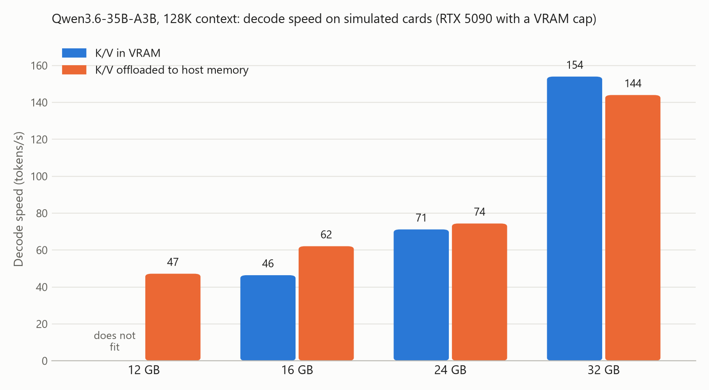

# Training-free block selection and KV offload for a hybrid MoE model

> **A patch for [Strata](https://github.com/Niko1221/Strata) (MIT).** Made against Strata 0.1.58; also applies cleanly to 0.1.60.1 (checked 2026-11-16).

Long contexts on a small GPU for **Qwen3.6-35B-A3B**, a model that mixes linear attention (Gated DeltaNet) with a few
full-attention layers and has no built-in sparse-attention indexer.

The idea: keep the full-attention K/V cache in **pinned host memory**, and at each decode step read only **96 blocks of
64 tokens** per KV head, chosen by a **training-free** score. A small GPU cache of recently used blocks keeps most reads
off the PCIe bus. The VRAM this frees can then hold more MoE experts.

This is implemented as a patch to the [Strata](https://github.com/Niko1221/Strata) inference engine (MIT) and measured
on one RTX 5090. Smaller cards are **simulated** on the 5090 with a VRAM cap (see [Limitations](#limitations)).

## What is in this repository

| Path | What it is |
| --- | --- |
| `strata-patch/q36_engine.cu.diff` | Changes to Strata's `src/qwen35/q36_engine.cu` (317 lines of unified diff) |
| `strata-patch/q36_sel.cuh` | New CUDA header: block scoring, top-96 pick, GPU block pool, split-K attention over the selected blocks |
| `scripts/sel_eval.py` | Quality test: dense vs selection (teacher-forced agreement, free-run agreement, needle in a haystack) |
| `scripts/run_public_eval.ps1` | Runs `sel_eval.py` at 60K and 120K tokens with K/V offload on |
| `scripts/bench_vram_cap.ps1` | Speed matrix: simulated cards (12–32 GB by default), K/V in VRAM vs offloaded |
| `scripts/build_strata.ps1` | Windows build (MSVC + CUDA 13.0 + Ninja) |
| `results/` | Logs of the runs reported below |
| `figures/` | The figure below and `make_figure.py`, which draws it from the numbers in the table |
| `THIRD_PARTY/STRATA_LICENSE` | Strata's MIT license (the patch modifies Strata code) |

## How it works

Qwen3.6-35B-A3B has 40 layers; 10 of them (plus the MTP block) use full attention with 2 KV heads, 8 query heads per KV
head and head dim 256. Strata stores this K/V in fp32 on the GPU, about 45 KB per token, so 128K tokens need about
5.9 GB of VRAM, which on a 12–16 GB card competes directly with the expert cache.

The patch adds three environment switches (all off by default; with none set the engine behaves as before):

1. **`STRATA_Q36_SEL=1`: training-free block selection.** For every KV head, every 16 cells a window of 32 keys is
   averaged. At each decode step the query's softmax weight over these window means is summed over the 8 query heads,
   max-pooled over the 5 windows that overlap each 64-cell block, and the top blocks are kept. Block 0 and the newest 8
   blocks are always kept; 96 blocks (6,144 tokens) are read in total. This is the InfLLM-v2 / MiniCPM4 style of score,
   applied to a model that was never trained for it. Everything runs on the GPU inside Strata's CUDA graph.
2. **`STRATA_Q36_KVHOST=1`: K/V in pinned host memory.** The full-attention K/V is allocated with `cudaHostAlloc` and
   the attention kernel reads the selected rows directly (zero-copy). All 8 query heads of a KV head share one read of
   each row.
3. **`STRATA_Q36_KVPOOL=256`: GPU block pool.** Each layer and KV head keeps 256 recently used blocks in VRAM (LRU),
   plus a 16-block ring that mirrors the newest blocks as they are written. Only missed blocks cross PCIe. The pool costs
   about 0.71 GiB of VRAM.

Two supporting changes:

- **`STRATA_Q36_VRAM_CAP=<GiB>`** makes every free-memory query in the engine report a smaller card, so the engine
  places experts and buffers as it would on that card. It changes decisions only; it does not enforce the limit (peaks
  were checked with `nvidia-smi`, see below).
- **Per-layer pinning.** Windows limits page-locked memory to roughly half of physical RAM. With K/V also pinned, the
  engine's single 18.75 GiB pinned allocation for experts failed and all experts fell back to pageable memory, which
  halved prompt speed. The patch now pins expert layers one by one until the limit is reached (on the test machine 38 of
  40 layers, 17.25 GiB). Note: the engine's later status line still says "all 18.75 GiB in pageable host memory"; that
  line is upstream text the patch did not update.

## Results

All numbers are from one PC: RTX 5090 (32 GB), Ryzen 9 9950X, 47 GiB RAM, Windows 11, model
`Qwen3.6-35B-A3B-UD-Q4_K_XL.gguf`. Speed benchmarks use Strata's `--bench-pp N --bench-tg 64` on random tokens, three runs
each.

### Decode speed at 128K tokens (full 5090, no cap)

| Setting | Decode tok/s |
| --- | --- |
| Dense attention, K/V in VRAM (Strata as is) | 17–18 |
| Selection, K/V in VRAM | 151.9–163.3 |
| Selection, K/V in pinned host memory, direct reads | 102.1–102.9 |
| Selection, K/V in host memory + 256-slot pool + ring | 147.9–148.7 (pool hit rate 88.6%) |

On 60K tokens of real text the pool version decodes at 164 tok/s against 177 tok/s with K/V in VRAM (about 7.5%
slower). The goal was at most 5% slower; that is not reached yet.

### Simulated smaller cards, 128K context (after the pinning fix)

A = selection with K/V in VRAM, C = selection with K/V offloaded (pool + ring).



| Card (simulated) | A decode | A prefill | C decode | C prefill | Experts in VRAM (A / C) |
| --- | --- | --- | --- | --- | --- |
| 12 GB | does not fit | — | 46.1–48.0 | 1383–1388 | — / 2 of 256 |
| 16 GB | 46.4 | 2174 | 61.4–63.0 | 1946–1950 | 0 / 50 of 256 |
| 24 GB | 71.2 | 2172 | 71.2–76.1 | 2069–2360 | 100 / 160 of 256 |
| 32 GB | 154 | 2189 | 144 | 2024 | all / all |

The C values for 12–24 GB are from the run after the pinning fix (`results/strata_small6.log`); the A column and the
32 GB row are from the full matrix run before it (`results/strata_small5.log`, `strata_small5_summary.txt`). The fix
only changes how the experts' host memory is pinned; in A the 18.75 GiB of experts fit under the pinning limit on
their own, so A should be unaffected (not re-measured).

- **12 GB:** with K/V in VRAM the 128K context leaves no room and the engine exits; with offload it runs.
- **16 GB:** offloading frees VRAM for 50 more experts per layer, so decoding is about 33% faster. The prompt is
  processed about 10% slower, which adds about 6 s before the first token of a 120K-token prompt.
- **32 GB:** everything fits anyway, and offload is about 6.5% slower. Offload only pays off when VRAM is short.
- **8 GB does not work** in the current design: even at an 8K context only about 0.1 GiB is left after the weights and
  buffers, and the expert staging buffers alone need about 1.1 GiB (a 10 GB cap works at 32K).
- Measured `nvidia-smi` peaks were 12,747, 16,903 and 25,173 MiB for the 12, 16 and 24 GiB caps, so the soft cap was
  exceeded by 0.45–0.6 GiB (the numbers include about 1.2–1.9 GiB used by the Windows desktop).

### Quality: selection vs dense attention

Reference: the same engine with dense attention, greedy decoding. *Teacher-forced agreement* feeds the dense output back
in and counts the steps where the selection version picks the same top-1 token. *Needle*: a passcode inserted at 20%,
50% and 80% depth.

**Public corpus (Strata's own source code, `include/` and `src/` without `src/qwen35/`), K/V offloaded:**

| Context (prompt tokens) | q1 | q2 | q3 | q4 | Mean agreement | Needle 20/50/80% (dense / selection) | Pool hit rate |
| --- | --- | --- | --- | --- | --- | --- | --- |
| 59,907–59,913 (160 steps) | 0.950 | 0.938 | 0.925 | 0.969 | 0.945 | 3/3 / 3/3 | 93.0–96.8% |
| 118,525–118,531 (96 steps) | 0.917 | 0.885 | 0.969 | 0.979 | 0.938 | 3/3 / 3/3 | 90.6–94.9% |

The questions ask about the code base's structure, languages, KV-cache/memory code and build steps (see
`scripts/sel_eval.py`). Greedy free-running outputs first diverge from the dense output after 9–72 tokens. Logs:
`results/sel_eval_public60k.log`, `results/sel_eval_public120k.log`.

Earlier runs on a private code base (not reproducible from this repository, listed for completeness): mean agreement
0.9625 at 59K tokens and 0.9505 at 115K tokens, needle 3/3 at both; with a 16 GB cap at 59K tokens 0.9563, needle 3/3.
K/V direct reads, pool and pool + ring gave identical outputs, so the cache returns the same data as host memory.

### Memory requirements (estimates, not measured)

The engine keeps all experts (18.75 GiB) in host memory. Estimated minimum RAM: about 24 GiB for 32K and 28–30 GiB for
128K. Machines with 16 GiB RAM are not supported.

## Build and run

1. Get Strata (MIT): `git clone https://github.com/Niko1221/Strata`. The patch was made against Strata 0.1.58 (source
   tree of 2026-11-06); the diff touches only `src/qwen35/q36_engine.cu` and may need small adjustments on later
   versions.
2. Copy `strata-patch/q36_sel.cuh` to `src/qwen35/` and apply the diff:
   `git apply strata-patch/q36_engine.cu.diff`
3. Build the `strata-q36` target (`scripts/build_strata.ps1` shows the Windows command line; set the paths for your
   machine).
4. Run with offload, for example:

   ```
   set STRATA_Q36_SEL=1
   set STRATA_Q36_KVHOST=1
   set STRATA_Q36_KVPOOL=256
   strata-q36 --model Qwen3.6-35B-A3B-UD-Q4_K_XL.gguf --ctx 131072 --bench-pp 120000 --bench-tg 64
   ```

5. Quality test: `python scripts/sel_eval.py` (paths are set with the `SEL_*` environment variables at the top of the
   script).

## Limitations

- **One machine, simulated small cards.** All runs use an RTX 5090 (1.8 TB/s VRAM, PCIe 5.0 x16). Real 12–16 GB cards
  have much less memory bandwidth and often PCIe 4.0 x8, so absolute speeds and possibly the A/C comparison will differ.
- **Small quality sample.** One code base per test, four questions, each run once, no confidence intervals. The reference
  is the engine's own dense output, not a human judgment of correctness. Free-running generations diverge early (as
  expected for greedy decoding).
- **Speed uses random tokens.** Pool hit rate on random tokens (88.6%) is lower than on real text (about 91–97%).
- **Agreement varies by question.** At 120K one question dropped to 0.885 while another reached 0.979; four questions
  are too few to say how it depends on context length.
- **Not yet ≤5% slower** than K/V in VRAM at equal VRAM; the gap is 3–9% depending on the run.
- **Single session only.** Selection is enabled only when Strata runs one session (`--batch` is not supported).
- 8 GB cards and systems with less than ~24 GiB RAM are not supported.

## Related work

- **Strata** (Niko1221, MIT) already streams K/V from host memory for the natively sparse attention layers of
  Qwen3.8-Flash-Next, using that model's trained indexer. This project fills the gap for a hybrid model without an
  indexer, inside the same engine.
- **InfLLM-V2** (Zhao et al., 2025, [arXiv:2509.24663](https://arxiv.org/abs/2509.24663)): trainable dense-sparse
  attention; the block score used here follows its compressed-key / max-pool design, without training.
- **Quest** (Tang et al., 2024, [arXiv:2406.10774](https://arxiv.org/abs/2406.10774)): query-aware page selection from
  per-page key min/max.
- **ShadowKV** (Sun et al., 2024, [arXiv:2410.21465](https://arxiv.org/abs/2410.21465)): low-rank keys on the GPU, values
  offloaded to the CPU.
- **NOSA** (Huang et al., 2025, [arXiv:2510.13602](https://arxiv.org/abs/2510.13602)): trainable sparse attention with a
  locality constraint designed for KV offloading.

## License

MIT, see `LICENSE`. The files under `strata-patch/` modify Strata, which is MIT licensed by Niko1221 and the Strata
contributors; its license is in `THIRD_PARTY/STRATA_LICENSE`. Model weights keep their own licenses.
